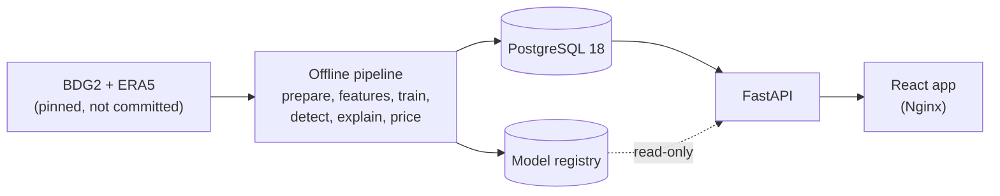

# WattWise AI

**Explainable energy-waste detection for commercial buildings.**

WattWise compares what each meter recorded with what a model expected under the same weather and
calendar, raises alerts where they differ, shows the evidence, estimates the **potential** excess
energy, cost and carbon, and lets an operator review each alert. It is built on real data, the
[Building Data Genome Project 2](#data-and-licences) (1,148 meters, 2016–2017), and says plainly
what it does not know.

> **Status.** The original roadmap (T001–T045) is done. **Live demo (synthetic data, static,
> read-only):** <https://shvhjsb.github.io/wattwise-ai/> (T050,
> [how](docs/DEPLOYMENT.md#public-static-demo-on-github-pages-t050-d068)); a server version is
> ready for Render (T046);
> T047–T049 (Data health, data drift, What-if lab) are done ([PROJECT_STATUS.md](docs/PROJECT_STATUS.md)).
> The application runs locally and as a Docker Compose demo. It is **not deployed** anywhere and
> has **no authentication**. Every result quoted below links to the section of
> [docs/EVALUATION.md](docs/EVALUATION.md) that records the command that produced it.

## What it does

An operator gets answers to five questions:

1. **What should this meter have used?** A LightGBM model's expected consumption, with a 90%
   interval whose coverage is measured, not assumed.
2. **When is consumption abnormal?** Alerts from a rolling same-hour z-score, chosen by a
   pre-stated benchmark rule, each labelled with a signature: spike, sustained excess, overnight
   base load, drift, flatlined meter or data fault.
3. **How much might it have cost?** Energy above the interval's upper bound, priced only with a
   tariff the user chooses and converted to carbon only with a sourced factor. Always "potential".
4. **What is the evidence?** For each alert: the readings against the expectation, the signature's
   evidence, the model's largest influences (associations, not causes) and things to check.
5. **What first?** A transparent priority score (impact, persistence, severity, confidence).

**What it will not say:** that an anomaly is confirmed waste, that a potential saving is verified,
or that an influence is a cause. Synthetic data is labelled synthetic everywhere it appears.

## The application

| Page | What you see |
|---|---|
| **Overview** | Measured energy, open alerts, potential excess (marked as an estimate), data quality and coverage, kept separate for observed and synthetic data |
| **Buildings & meters** | A meter's readings against the model's expectation and 90% interval, the difference, and alert windows; an hour-by-hour readout and a data table |
| **Alerts** | A priority-ordered queue with filters, each alert's evidence and explanation, and reviewer feedback (stored, never used to retrain) |
| **Cost impact** | Potential energy per kind of data, an explicit tariff scenario, and carbon from sourced factors |
| **What-if lab** | A meter's recorded use against the model's expectation, with the potential-excess rule, a hypothetical cut in chosen local hours and an optional entered tariff; nothing is saved and history is never changed |
| **Bill analyser** | The figures of a monthly electricity bill, entered by hand, checked against the bill's own total and turned into where the money goes, the demand charge, time-of-day shifts (hypothetical), power factor and the last months' history; computed in the browser, nothing is sent or saved. A bill comes from one meter, so it cannot show which machine uses what |
| **Data health** | Each dataset's stored data-quality audit: coverage, gaps, missing values, flatlines, zero runs, out-of-range values, duplicate handling, and recent uploads |
| **Model lab** | The served model, its recorded test results against a baseline, data drift over the evaluation window, dataset health and recent analyses |

Behind it is a FastAPI service with OpenAPI docs (`/docs`). It covers buildings, meters,
expectations, alerts and feedback, impact, data-quality audits, CSV upload and analysis,
and model information.

## Architecture



More: [docs/ARCHITECTURE.md](docs/ARCHITECTURE.md).

| Layer | Technology |
|---|---|
| Frontend | React 19, TypeScript, Vite, Tailwind CSS, hand-written SVG charts |
| API | Python 3.13, FastAPI, Pydantic, SQLAlchemy 2, Alembic, PostgreSQL 18 |
| ML | pandas, NumPy, LightGBM, scikit-learn; TreeSHAP for influences |
| Operations | Docker Compose, Nginx, GitHub Actions, uv and npm lockfiles |

## Quickstart

**The synthetic demo** (Docker Desktop's Linux engine running), from this directory:

```bash
docker compose up --build -d --wait --wait-timeout 180
```

Open <http://127.0.0.1:8080>. It builds the images, migrates a separate PostgreSQL database, and
trains a model on a small, clearly labelled **synthetic** dataset. No real data or local
credentials are used. See [docs/CONTAINERS.md](docs/CONTAINERS.md).

**Development:** the API (`uv sync --locked`, then `uv run uvicorn wattwise.api.main:create_app
--factory`) and the app (`npm ci`, then `npm run dev`); see [backend/README.md](backend/README.md),
[frontend/README.md](frontend/README.md) and [docs/DATABASE.md](docs/DATABASE.md).

**Real data:** downloading BDG2 is an explicit, checksum-verified command, followed by
preparation, training and loading. The steps are in [docs/DATASETS.md](docs/DATASETS.md),
[docs/EVALUATION.md](docs/EVALUATION.md) and [docs/DATABASE.md](docs/DATABASE.md).

**A private host:** [docs/DEPLOYMENT.md](docs/DEPLOYMENT.md) is a loopback-only recipe, verified
locally and in CI. It is not a deployed service.

## How the ML works

1. **Data.** BDG2 electricity readings, converted to one canonical shape in UTC after a per-site
   clock audit ([DATA_CONTRACT.md](docs/DATA_CONTRACT.md), [DATASETS.md](docs/DATASETS.md)).
   Quality problems are reported, never silently fixed ([DATA_QUALITY.md](docs/DATA_QUALITY.md)).
2. **Features.** Local calendar and holidays, weather, ERA5 radiation, sun position and the meter's
   own history, every input known at least a week ahead ([FEATURES.md](docs/FEATURES.md)).
3. **Splits.** Chronological: train to June 2017, validate July–September, test October–December,
   scored once. Building and site hold-outs test generalisation ([EVALUATION.md](docs/EVALUATION.md#splits-t010)).
4. **Model.** LightGBM with L1 loss, adopted only because it beat the seasonal-naive baseline on
   test under a rule fixed beforehand ([MODEL_CARD.md](docs/MODEL_CARD.md)).
5. **Intervals.** Rolling relative conformal intervals, reported with their measured coverage.
6. **Detection.** A rolling same-hour z-score, chosen over two model-based detectors by an
   injected-anomaly benchmark, then checked against human labels ([DETECTION.md](docs/DETECTION.md)).
7. **Evidence, impact, priority.** Signatures, explanations with a wording guard, potential
   excess (meter problems excluded), and a documented priority score.

## Results

All on real BDG2 data at full scale; each links to its record.

| Question | Result | Record |
|---|---|---|
| How accurate is the expected consumption? | Test MAE 13.700 kWh against 16.705 for seasonal-naive: **18.0% lower** | [T043](docs/EVALUATION.md#best-model-at-full-scale-t043-d036) |
| On buildings or sites it never saw? | 15.7% lower (unseen buildings), **8.5% lower** (unseen sites) | [T043](docs/EVALUATION.md#best-model-at-full-scale-t043-d036) |
| Does the 90% interval hold? | **87.2%** of test readings fell inside it | [T044a](docs/EVALUATION.md#downstream-pipeline-at-full-scale-t044a-d039-d040-d041) |
| How well does the default detector find injected anomalies? | 70.0% recall at 0.34 alerts per meter-week (synthetic anomalies on real data) | [T044b](docs/EVALUATION.md#detector-benchmark-at-full-scale-t044b-d042) |
| And real ones, labelled by a person? | 18.9% of labelled segments found; 22.7% of its events touch a label (chance 1.5% per hour) | [T044c](docs/EVALUATION.md#detector-check-against-lead-labels-at-full-scale-t044c-d043) |
| How much potential excess? | 558,722 kWh and 220,140 kg CO2e over 5,084 counted alerts: **potential, not verified** | [T044a](docs/EVALUATION.md#downstream-pipeline-at-full-scale-t044a-d039-d040-d041) |

## Limitations

- **One dataset**, mostly university campuses, two years, North America and Europe. Results
  elsewhere are mostly unknown. On one independent campus (HKUST, Hong Kong, T041) the model,
  not retrained, beat seasonal-naive by 6.6 % against 18.0 % on BDG2
  ([report](docs/reports/hkust-generalisation.md)). A one-building
  case study on LBNL Building 59 (T040) found that the default detector does not flag a
  gradual regime change such as the COVID shutdown
  ([report](docs/reports/lbnl59-case-study.md)).
- **The detector misses much of what people label.** It is designed to stay within a budget of
  0.5 alerts per meter-week, and its persistence rules mostly ignore short events: one or two
  hours, which are 70% of the labelled segments.
- **Labels from one annotator** with unmeasured agreement; feedback is collected but nothing is
  learned from it yet.
- **No authentication or authorisation.** Keep the application on loopback or behind a private
  tunnel ([SECURITY.md](docs/SECURITY.md)).
- Open questions are tracked in [PROJECT_STATUS.md](docs/PROJECT_STATUS.md): an event cluster on
  a US clock-change date, a few meters with very wide intervals, and 24 meters with no stored
  expectation.

## Data and licences

The primary dataset is the [Building Data Genome Project 2](https://github.com/buds-lab/building-data-genome-project-2)
(Miller et al., 2020, *Scientific Data* 7, 368, <https://doi.org/10.1038/s41597-020-00712-x>).
Its licence is stated differently by its sources, so WattWise follows the most restrictive
reading: it attributes the source and **never redistributes raw or derived BDG2 data**. Weather
enrichment is ERA5 via Open-Meteo (CC BY 4.0, used non-commercially); human anomaly labels are
LEAD 1.0, used locally only. Nothing third-party is committed except small, cited reference
tables of carbon factors and prices. Details: [LICENSES.md](LICENSES.md) and
[docs/DATASETS.md](docs/DATASETS.md).

## Project records

- [docs/ROADMAP.md](docs/ROADMAP.md): milestones, tasks and acceptance criteria
- [docs/PROJECT_STATUS.md](docs/PROJECT_STATUS.md): current status and next task
- [docs/DECISIONS.md](docs/DECISIONS.md): every significant choice, with the alternatives
- [docs/EVALUATION.md](docs/EVALUATION.md), [docs/DETECTION.md](docs/DETECTION.md),
  [docs/MODEL_CARD.md](docs/MODEL_CARD.md): methods and measured results
- [docs/WORK_LOG.md](docs/WORK_LOG.md) and [CHANGELOG.md](CHANGELOG.md): what changed and when
- [docs/specs/](docs/specs/): the original product and dataset specifications

## Licence

Code is released under the [MIT License](LICENSE). Datasets keep their own licences and are not
redistributed; third-party software licences are listed in [LICENSES.md](LICENSES.md).
