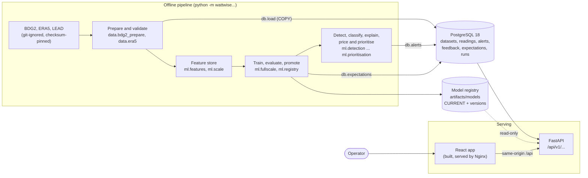
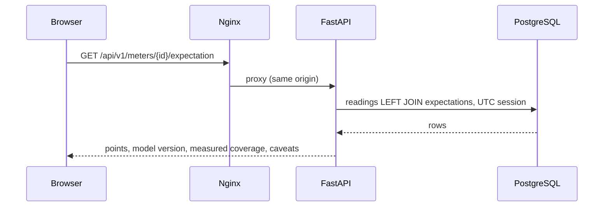

# Architecture

How WattWise AI is put together: an **offline pipeline** that prepares data, trains and checks
the model and detects anomalies; a **PostgreSQL database** holding what the application serves;
a **FastAPI** service; and a **React** application. Decisions are cited by number
([DECISIONS.md](DECISIONS.md)).

## The system

The pipeline and the API share one Python package, `wattwise` (src layout, D002). Rule: `ml` and
`data` never import `api`, so every analysis runs from the command line without the web server.

## The offline pipeline

Each step is a command that writes a manifest with hashes, so a result names its inputs.

| Step | Module | Output | Decision |
|---|---|---|---|
| Fetch and verify | `data.bdg2`, `data.lead`, `data.era5` | `data/raw/`, pinned by commit and SHA-256 | D014, D022, D023 |
| Audit clocks, prepare | `data.bdg2_audit`, `data.bdg2_prepare` | Canonical Parquet tables in UTC, an exclusion log | D016, D017, D020 |
| Validate against the contract | `data.validation`, `data.quality` | Rejects malformed data; reports quality without fixing it | D012, D015 |
| Features | `ml.features`, `ml.scale` | A float32 feature store; every input known a week ahead | D025, D035 |
| Split, train, evaluate | `ml.splits`, `ml.evaluation`, `ml.fullscale`, `ml.registry` | Chronological splits; a promoted, hash-verified model only if it beats seasonal-naive | D018, D021, D036, D039 |
| Intervals | `ml.intervals` | Rolling relative conformal intervals with measured coverage | D032, D041 |
| Detect and classify | `ml.detection`, `ml.signatures` | Events from the rolling z-score, labelled by signature | D028–D030, D042 |
| Explain, price, prioritise | `ml.explanations`, `ml.impact`, `ml.prioritisation` | Evidence bundles, potential excess with sourced carbon, a priority score | D034, D038, D040, D044 |
| Load into the database | `db.load`, `db.alerts`, `db.expectations` | Datasets, readings, alerts and expectations | D046, D047, D052 |

Alert reloads match on meter, detector and start, so reviewers' feedback survives a re-run
(D047). Expectations are stored only for the model's validation and test windows (D052).

## Storage

| Table | Holds | Written by |
|---|---|---|
| `datasets` | One row per dataset: its **kind (synthetic or observed)**, provenance and totals computed at load time | `db.load` |
| `buildings`, `meters` | The data contract's entities, with its rules as constraints | `db.load` |
| `readings` | Hourly values; NULL means not measured, never 0 | `db.load` (COPY) |
| `alerts`, `alert_feedback` | Events with their evidence bundle, priority and severity; an append-only review history | `db.alerts`, the feedback API |
| `expectation_sets`, `expectations` | The model's expectation and interval for the evaluation windows, and which model made them | `db.expectations` |
| `analysis_runs` | One monitoring record per uploaded-data analysis, never the data itself | the analyze API |

Migrations (Alembic, `0001`–`0006`) live inside the package, so an image carries them; readiness
checks that the database is at the head revision (D045). Model artifacts live outside the
database, in a hash-verified registry that the API reads but never writes (D027).

## The API

FastAPI, typed Pydantic schemas, OpenAPI at `/docs`. All timestamps are UTC; every data response
carries its `data_kind`; unavailable things are said to be unavailable, never filled in (D046,
D049).

| Area | Endpoints |
|---|---|
| Health | `GET /health` (liveness), `GET /ready` (database reachable and migrated) |
| Catalogue | `GET /buildings`, `/buildings/{id}`, `/meters`, `/meters/{id}`, `/meters/{id}/series`, `/meters/{id}/expectation` |
| Overview | `GET /dashboard/summary` |
| Alerts | `GET /alerts`, `/alerts/{id}`; `POST /alerts/{id}/feedback` |
| Impact | `GET /impact/summary` (with an explicit tariff scenario) |
| Uploads | `POST /data/upload` (validate only), `POST /inference/analyze` |
| Models | `GET /models/metadata`, `/models/metrics`, `/models/evaluation`, `/analysis-runs` |

A request passes through bounded-request middleware (size, concurrency, deadline), an explicit
CORS allow-list and privacy-preserving access logs (D059).

## The application

React 19, TypeScript, Vite and Tailwind CSS (D008). Every response is checked at runtime against a
type guard (D009). Colours are tokens with light, dark and system themes, with tested contrast
(D050). Charts are small hand-written SVG components, so a missing reading is always a gap and
never a zero (D052).

| Page | Shows | Task |
|---|---|---|
| Overview | Six figures per kind of data, each with its definition and source | T029, D051 |
| Buildings & meters | Readings against the expectation and 90% interval, with the difference and alert windows | T030, D052 |
| Alerts | A priority-ordered queue, each alert's evidence and explanation, and reviewer feedback | T031, D053 |
| Cost impact | Potential energy, a tariff scenario and sourced carbon, kept per kind of data | T032, D054 |
| Model lab | The served model, its recorded evaluation, dataset health and analysis runs | T033, D055 |

A demo-data banner appears while synthetic data is stored, and provenance badges mark each item.

## Running it

| Setting | What runs | Guide |
|---|---|---|
| Development | `uvicorn` and `npm run dev` against a local PostgreSQL | [backend/README.md](../backend/README.md), [frontend/README.md](../frontend/README.md) |
| Synthetic demo | Docker Compose: PostgreSQL, a one-shot migrate-and-seed, the API and Nginx on `127.0.0.1:8080` | [CONTAINERS.md](CONTAINERS.md), D058 |
| Private host | A loopback-only recipe with digest-pinned images, mounted secrets, read-only containers and a release gate | [DEPLOYMENT.md](DEPLOYMENT.md), D060 |

There is no authentication. Do not expose the application beyond loopback or a private tunnel
without a reviewed access-control design ([SECURITY.md](SECURITY.md)).

## Verification

| Layer | How it is checked |
|---|---|
| Backend | pytest with a real PostgreSQL 18 (a fresh schema per test), ruff, strict mypy |
| Pipeline | One integration test from the synthetic CSV fixture through migrations, training, detection and the API (D056) |
| Frontend | Vitest and Testing Library, ESLint, TypeScript, a contrast test over the colour tokens |
| Browser | Playwright on Chromium (desktop light and dark, and mobile), against a real API fixture (D057) |
| Containers | Image builds, smoke checks through Nginx, persistence across recreation, the deployment verifier (D058, D060) |
| Supply chain | Locked, audited dependencies; full-history secret scanning (D059) |

All of these run in CI on every push ([`.github/workflows/ci.yml`](../.github/workflows/ci.yml)).
